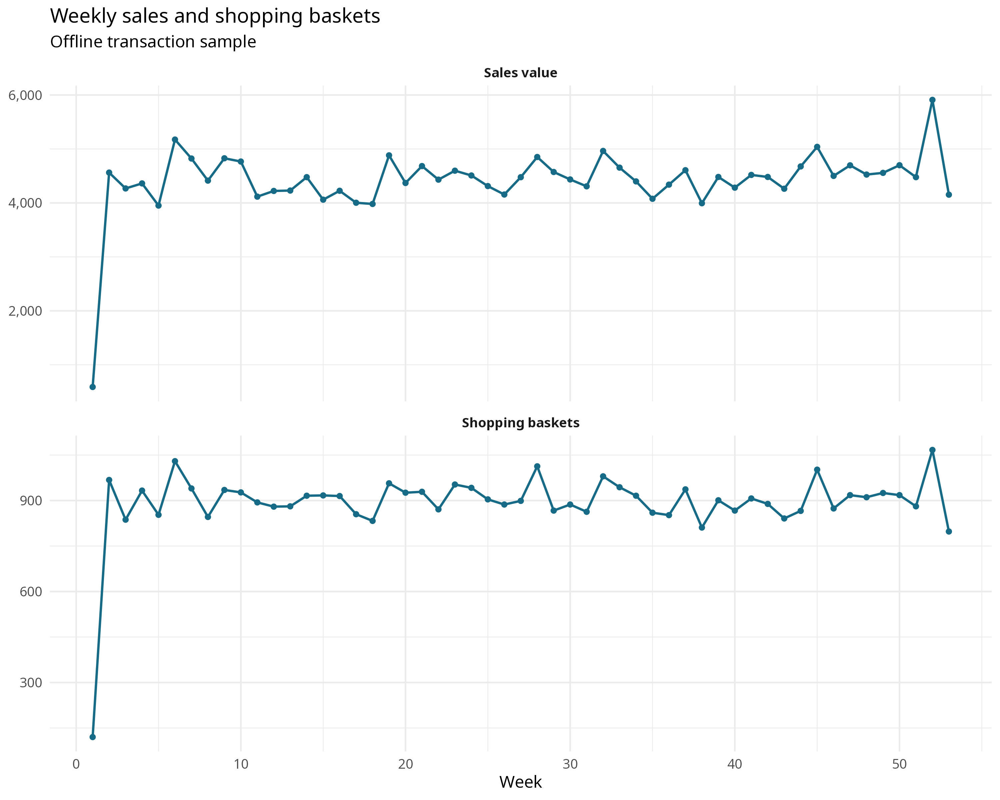
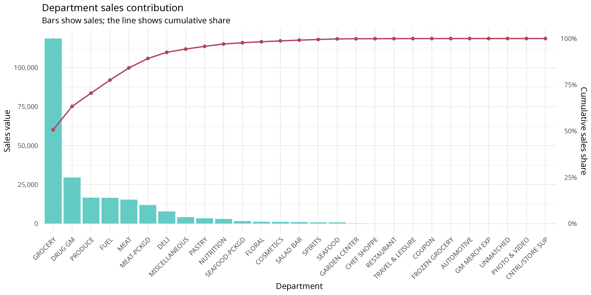
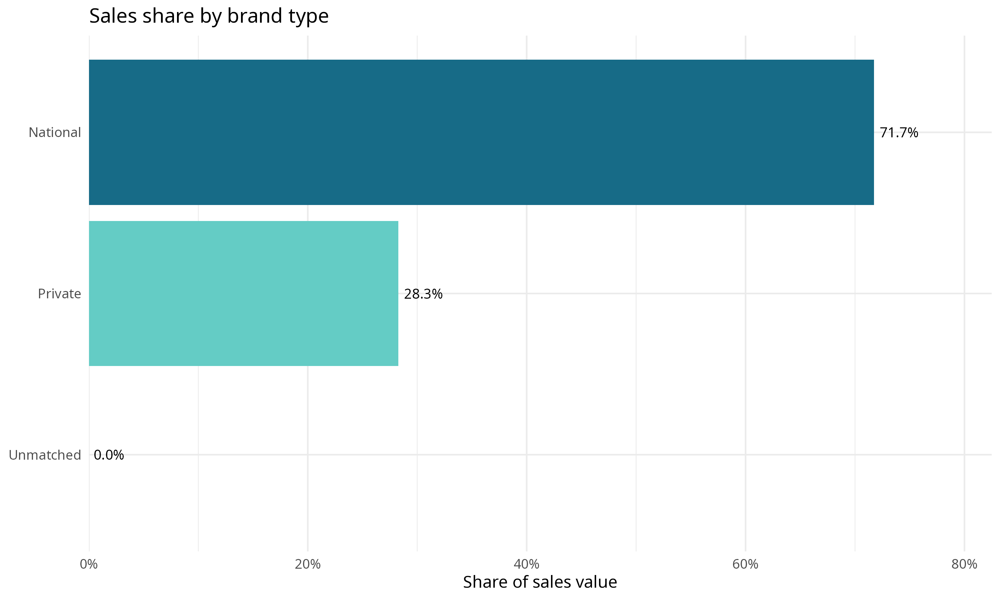
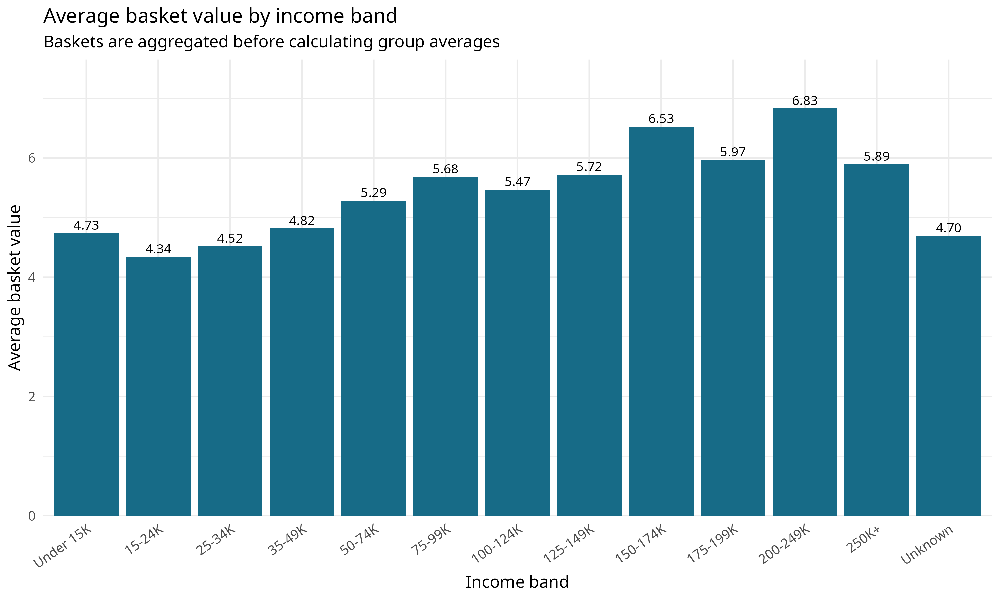
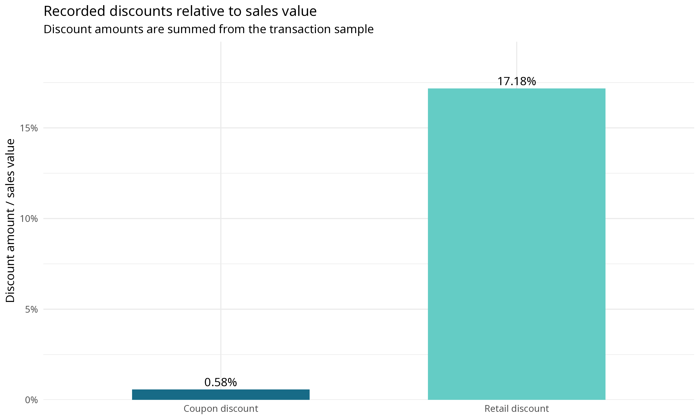
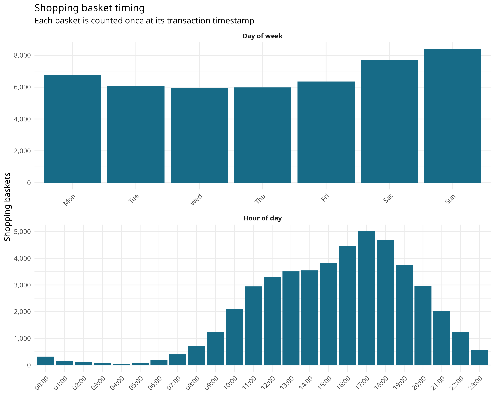

# Retail Tidyverse EDA

Coursework-inspired project, independently rebuilt on public data (Oct 2026)

This repository presents an exploratory retail analysis using R and the tidyverse. It was developed by Jiayi Zou as an independent portfolio project. Its purpose is to demonstrate reproducible data preparation, relational joins, aggregation and visualisation around operations and retail-management questions.

The analysis uses only datasets bundled with the `completejourney` package, so it can be run offline after the package and its dependencies have been installed.

## Data source and licence

The data are the public sample from **“The Complete Journey”**, originally made available by **84.51° / dunnhumby**, and distributed through the R package [`completejourney`](https://github.com/bradleyboehmke/completejourney), by **Boehmke et al.** The package and its bundled data are released under **CC0**. The transaction sample covers 75,000 rows from 2017.

The analysis uses `transactions_sample`, `products`, `demographics`, `campaigns`, `campaign_descriptions`, `coupons`, `coupon_redemptions` and `promotions_sample`. It does not call `get_transactions()` or `get_promotions()`, which retrieve additional data from the internet.

## Questions

1. How do weekly sales value and shopping-basket counts change over time?
2. Which departments contribute most to sales, and how concentrated is the sales distribution?
3. How is sales value shared between private-label and national brands?
4. How does average basket value vary across household income bands?
5. How large are recorded retail and coupon discounts relative to sales value?
6. How are shopping baskets distributed by day of week and hour of day?

## How to run

The project was written for **R 4.5** and **tidyverse 2.0**. It requires:

- `completejourney`
- `tidyverse` components: `dplyr`, `ggplot2`, `tidyr`, `readr`, `lubridate` and `scales`

Install the required CRAN packages if necessary:

```r
install.packages(c(
  "completejourney", "dplyr", "ggplot2", "tidyr",
  "readr", "lubridate", "scales"
))
```

From the repository root, run:

```sh
Rscript R/analysis.R
```

The script creates `figures/` and `outputs/`, saves every chart as a PNG, writes the underlying summaries as CSV files and prints the key tables to the console. No sampling or internet connection is used, and a fixed random seed is set so that repeated runs produce identical CSV outputs. A full run takes about five seconds.

## Repository structure

```text
retail-tidyverse-eda/
├── R/
│   └── analysis.R
├── figures/
│   ├── 01_weekly_sales_and_baskets.png
│   ├── 02_department_sales_pareto.png
│   ├── 03_brand_sales_share.png
│   ├── 04_income_average_basket_value.png
│   ├── 05_discounts_relative_to_sales.png
│   └── 06_shopping_time_distribution.png
├── outputs/
│   ├── brand_sales_share.csv
│   ├── department_sales_pareto.csv
│   ├── discount_summary.csv
│   ├── hourly_basket_distribution.csv
│   ├── income_average_basket_value.csv
│   ├── join_coverage.csv
│   ├── offline_data_coverage.csv
│   ├── shopping_time_distributions.csv
│   ├── weekday_basket_distribution.csv
│   └── weekly_sales_and_baskets.csv
├── .gitignore
├── LICENSE
└── README.md
```

## Figures

### Weekly sales and shopping baskets



### Department sales Pareto



### Brand sales share



### Average basket value by income



### Discounts relative to sales



### Shopping-time distribution



## Findings

All figures below come from the 75,000-row 2017 transaction sample (47,243 baskets) and are taken from the CSV files in `outputs/`. Sales values are in US dollars.

- **Sales are concentrated in a few departments.** Grocery accounts for 50.7% of sales value and the top five departments (Grocery, Drug GM, Produce, Fuel and Meat) for 84.1% (`department_sales_pareto.csv`).
- **National brands dominate.** National brands generate 71.7% of sales value and private-label products 28.3% (`brand_sales_share.csv`).
- **Basket value is generally higher in higher income bands, but not monotonically.** Average basket value is about $4.34 in the 15-24K band and $6.53 in the 150-174K band, yet it is $6.83 in the 200-249K band (only 121 baskets) and $5.89 at 250K+. The higher bands contain few baskets and 45% of baskets (21,366) have no income record (`income_average_basket_value.csv`).
- **Retail discounts far outweigh coupons.** Recorded retail discounts equal 17.2% of sales value, compared with 0.6% for coupon discounts (`discount_summary.csv`).
- **Weekends and late afternoons are busiest.** Sunday (17.8%) and Saturday (16.3%) have the largest shares of baskets, and 17:00 is the peak hour with 10.6% of baskets (`weekday_basket_distribution.csv`, `hourly_basket_distribution.csv`).
- **Weekly sales are broadly stable.** Excluding the partial first week, weekly sales range from about $3,951 (week 5) to $5,910 (week 52), with the year-end week also recording the most baskets at 1,067 (`weekly_sales_and_baskets.csv`).

## Limitations

- The transaction analysis uses only the **75,000-row transaction sample**, not the full transaction dataset. Results and patterns must not be interpreted as representative of the complete data.
- Product and demographic attributes may be missing. Unmatched or missing categories are retained explicitly, and households without demographic records are shown as an Unknown income group rather than imputed. 222 transaction rows have no matching product record.
- Average basket value is descriptive and does not establish a causal relationship with income.
- Recorded discount ratios depend on the package's field definitions and should not be interpreted as a complete measure of promotional cost or incrementality.
- The campaign, coupon and promotion tables are auxiliary inputs. Without a complete attribution design, they are not used to claim campaign effectiveness.
- This is an exploratory portfolio analysis rather than a forecasting, causal-inference or commercial decision study.

## Licence

**Licence: MIT** for the code in this repository. See `LICENSE`. The underlying data retain their original CC0 licensing and attribution.
